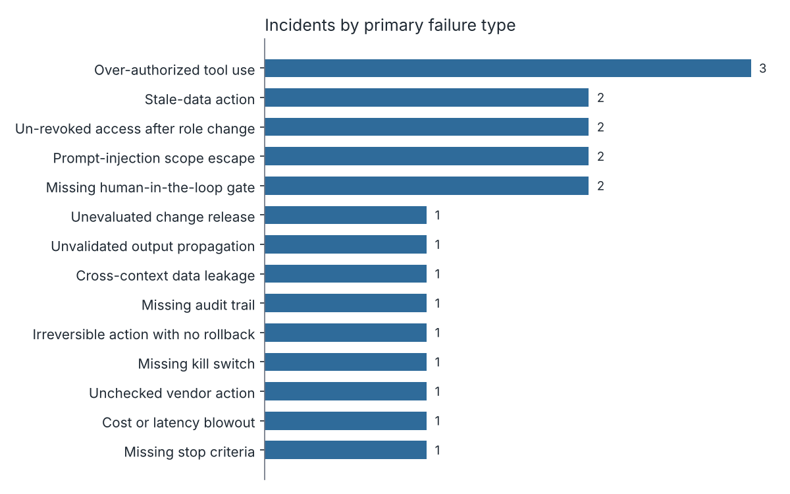

# Agent Incident Atlas

An open dataset of anonymized agentic AI failure incidents, organized for research and AI governance postmortems.

> **Honest status: the data is illustrative.** Version 0.1.0 contains 20 seed records. Every one is a fictional composite written by the maintainer to show the schema and the taxonomy at work. Each carries `"seed": true`. None describes a real organization or a real event, and nothing in them should be cited as evidence of how often any failure happens. The seed records will be replaced in importance, and eventually in number, as real contributions arrive. Until then, use the Atlas for its schema, its taxonomy, and its method.

## What this is

The Atlas is a place to record how agentic AI systems fail in production, in a form that researchers, red teams, and audit teams can compare across incidents. Each record is anonymized and tagged against a taxonomy of 14 governance failure types.

The taxonomy describes the control that was missing, not the model's mistake. Models will be wrong. The question that matters for enterprise AI is what let a wrong output become a payment, a deleted table, or a message to 14,000 students.

## Why it exists

Enterprises rarely fail at AI because the model is weak. They fail because they never settled three questions:

1. **Authorize.** What is this system permitted to do, and who approved that?
2. **Prove.** What evidence says it deserves that authority?
3. **Revoke.** How is the authority taken back when it stops deserving it?

Most published incident writeups describe what happened but not which control was missing, so they are hard to compare and hard to turn into audit tests. The Atlas records the missing control as a first-class field. Over time that lets a governance team ask which controls fail most often, in which sectors, for which kinds of agents.

## Taxonomy summary

Full definitions, tagging rules, and examples are in [`taxonomy.md`](taxonomy.md). Two people tagging the same incident should reach the same primary tag, and the file explains the rules that make that possible.

| Code | Failure type | Question |
|---|---|---|
| FT-01 | Over-authorized tool use | Authorize |
| FT-02 | Missing human-in-the-loop gate | Authorize |
| FT-03 | Un-revoked access after role change | Revoke |
| FT-04 | Prompt-injection scope escape | Authorize |
| FT-05 | Stale-data action | Prove |
| FT-06 | Unchecked vendor action | Prove |
| FT-07 | Missing stop criteria | Revoke |
| FT-08 | Cost or latency blowout | Authorize |
| FT-09 | Unvalidated output propagation | Prove |
| FT-10 | Cross-context data leakage | Authorize |
| FT-11 | Missing audit trail | Prove |
| FT-12 | Irreversible action with no rollback | Revoke |
| FT-13 | Missing kill switch | Revoke |
| FT-14 | Unevaluated change release | Prove |

## Schema overview

Each record is a JSON file in `data/incidents/`, validated by [`schema/incident.schema.json`](schema/incident.schema.json). Field-by-field guidance is in [`schema/FIELDS.md`](schema/FIELDS.md).

| Group | Fields |
|---|---|
| Identity | `id`, `seed`, `provenance`, `schema_version` |
| Context | `title`, `date` (or date range), `sector`, `agent_type`, `autonomy_level` |
| Classification | `failure_types` (1 to 3 tags), `primary_failure_type` |
| Account | `narrative` (150 to 300 words) |
| Consequence | `business_impact` (severity, categories, description), `root_cause` |
| Governance | `governance_gap` (control category, missing control, description) |
| Response | `detection` (method, time to detect), `lessons_learned` |

## Repository layout

```
agent-incident-atlas/
  schema/            JSON Schema, field guide, machine-readable taxonomy
  taxonomy.md        failure types, tagging rules, examples
  data/
    incidents/       one JSON file per incident
    atlas.json       all records in one file (generated)
    atlas.csv        flat export (generated)
  notebooks/         frequency analysis and postmortem template
  scripts/           validate.py, build_exports.py, check_release.py
  CONTRIBUTING.md    how to submit an incident
```

## How to use the data

Load the CSV:

```python
import pandas as pd

df = pd.read_csv("data/atlas.csv")
real = df[df["seed"] == False]          # community records only, once they exist
real["primary_failure_type"].value_counts()
```

Load the JSON:

```python
import json

records = json.load(open("data/atlas.json", encoding="utf-8"))
```

Always filter on `seed` before drawing any conclusion. Lists in the CSV are joined with `;` (tags and categories) or ` | ` (lessons).

Run the checks and rebuild the exports:

```bash
pip install -r requirements.txt
python scripts/validate.py
python scripts/build_exports.py
```

Starter notebooks:

- [`notebooks/01_failure_pattern_analysis.ipynb`](notebooks/01_failure_pattern_analysis.ipynb) counts failure types by sector, agent type, and authority question, and shows which controls were missing and which tags appear together.
- [`notebooks/02_postmortem_template.ipynb`](notebooks/02_postmortem_template.ipynb) walks through turning raw incident notes into a validated record.



*Seed data. This chart shows how the analysis runs, not what happens in the world.*

## Who this is for

- **AI safety researchers** who want a structured corpus of deployment failures with a stable taxonomy.
- **Red teams** who want realistic failure paths to test against, grouped by missing control.
- **Enterprise AI governance and audit teams** who want a checklist of controls drawn from incident patterns, and a format for their own postmortems.

## How to contribute

Real incidents are what make the Atlas useful. Read [`CONTRIBUTING.md`](CONTRIBUTING.md) for the anonymization rules, the review bar, and the pull request template. In short: no names of companies, products, or people, no identifying system details, aggregate numbers only, and a specific governance gap for every record. If you cannot share an event as it happened, a contributor-composite that merges several events is acceptable and must be labeled as such.

## Cite this work

Please cite the Atlas if you use the data, the schema, or the taxonomy. Machine-readable metadata is in [`CITATION.cff`](CITATION.cff), and GitHub shows a "Cite this repository" button.

Each release is archived on Zenodo. Cite the concept DOI to refer to the project as a whole, or a version DOI to refer to an exact release. The DOI is assigned when the first release is archived and will be added here and to `CITATION.cff`.

```bibtex
@dataset{gupta_agent_incident_atlas,
  author  = {Gupta, Nitin},
  title   = {Agent Incident Atlas},
  version = {0.1.0},
  year    = {2026},
  doi     = {10.5281/zenodo.XXXXXXX},
  url     = {https://github.com/OWNER/agent-incident-atlas}
}
```

Replace the DOI placeholder with the DOI shown on the Zenodo record.

## License

The dataset, schema, taxonomy, and documentation are licensed **CC-BY-4.0** (see [`LICENSE`](LICENSE)). The code, including scripts and notebook code, is licensed **MIT** (see [`LICENSE-CODE`](LICENSE-CODE)). [`LICENSE-NOTE.md`](LICENSE-NOTE.md) lists which license applies to which files.

## About

The Atlas is maintained by Nitin Gupta, an AI product leader and author of a forthcoming book on enterprise AI decision systems. It is an independent project. Views and content here are the author's own and do not represent any employer or any organization named in a contribution.
